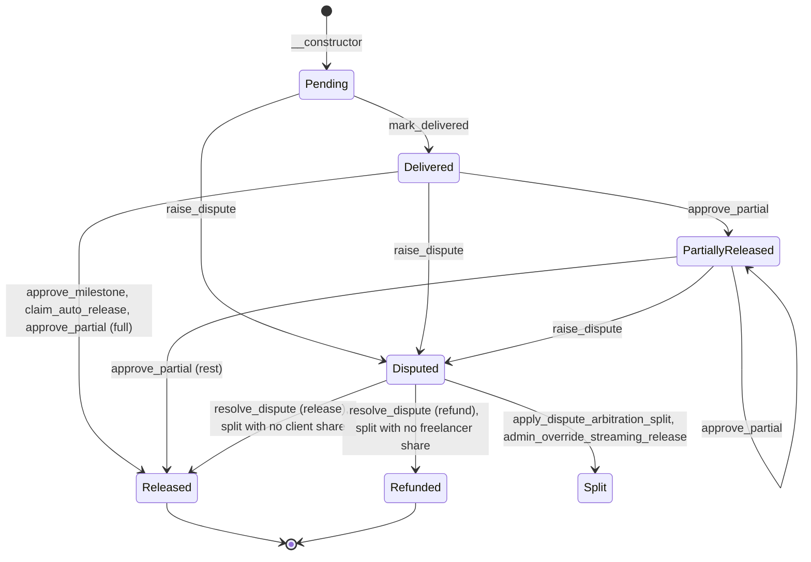
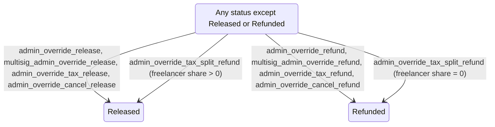
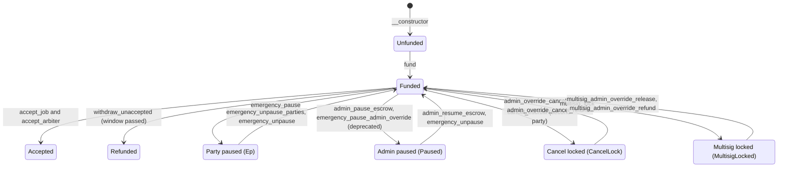

# Milestone Escrow: State Machine Specification

This document is the reference for every state transition in
`contracts/milestone-escrow/src/lib.rs`: which milestone and escrow-level states
exist, which entry point moves between them, who must sign, what tokens move and
which event is published.

PRs that add, remove or change a transition must update this file (see
`CONTRIBUTING.md`).

## Actors

| Actor | Set by | Notes |
|---|---|---|
| Admin | `__constructor`, `transfer_admin`, `execute_admin_transfer` | Platform operator. Controls overrides, pauses, fees, yield, whitelist and upgrades. |
| Client | `__constructor` | Funds the job and approves milestones. |
| Freelancer | `__constructor` | Delivers milestones and receives payouts. |
| Arbiter | `__constructor` | Resolves disputed milestones. |
| Multisig signer | `multisig_approval_init` | Approves proposal IDs (used by `execute_admin_transfer`). |
| Anyone | n/a | May call read-only and calculation endpoints, and `execute_admin_transfer` once it is approved. |

## Milestone states

`MilestoneStatus` has seven values:

| Status | Meaning |
|---|---|
| `Pending` | Created by `__constructor`; not yet delivered. |
| `Delivered` | Freelancer marked it delivered; the auto-release window is running. |
| `PartiallyReleased` | Client released part of the amount with `approve_partial`. |
| `Disputed` | Frozen for arbitration. |
| `Released` | Fully paid to the freelancer. Terminal. |
| `Refunded` | Remaining amount returned to the client. Terminal. |
| `Split` | Remaining amount divided between client and freelancer by an arbitration or streaming split. |

### Normal workflow

### Admin override transitions

## Escrow-level states

These are independent flags stored in instance storage, not mutually exclusive
states.

| Flag | Key | Set by | Cleared by | Checked by |
|---|---|---|---|---|
| Funded | `JobMeta.funded`, `DataKey::FundedAt`, `DataKey::FundedCount` | `fund`, or the last `fund_milestone` (when `FundedCount` reaches `milestone_count`) | never | most settlement entry points (`NotFunded`) |
| Acceptance | `DataKey::Acceptance` (bit 1 freelancer, bit 2 arbiter) | `accept_job`, `accept_arbiter` | never | `mark_delivered`, `raise_dispute`, `resolve_dispute`, `apply_dispute_arbitration_split` (`NotAccepted`), `withdraw_unaccepted` |
| Party pause | `DataKey::Ep` (with `DataKey::EpParty`) | `emergency_pause` | `emergency_unpause_parties`, `emergency_unpause` | `is_paused` |
| Admin pause | `DataKey::Paused` | `admin_pause_escrow`, `emergency_pause_admin_override` (deprecated alias) | `admin_resume_escrow`, `emergency_unpause` | `is_paused` |
| Cancel approval | `DataKey::CancelApproval` (`CancelApprovalRecord`: `mask` + `approved_at`) | `cancel_escrow` (first party) | `revoke_cancel_approval`, `cancel_escrow` (second party), expiry after `CANCEL_APPROVAL_TTL_SECONDS` | `cancel_escrow`, `revoke_cancel_approval` |
| Cancel lock | `DataKey::CancelLock` | `cancel_escrow` (second party) | `admin_override_cancel_release`, `admin_override_cancel_refund` | `ensure_not_paused` |
| Pause clock | `DataKey::PausedAt`, `DataKey::PausedSeconds` | the first active pause (`admin_pause_escrow`, `emergency_pause`, `emergency_pause_admin_override`, `cancel_escrow` lock) | the last pause ending (`admin_resume_escrow`, `emergency_unpause`, `emergency_unpause_parties`, cancel-lock settlement) | deadline calculations |
| Window baseline | `DataKey::WindowPauseBaseline(i)` | `set_milestone_due_dates`, `mark_delivered`, `raise_dispute` | `request_revision`, a cleared due date | `reclaim_overdue`, review/auto-release, dispute escalation |
| Multisig lock | `DataKey::MultisigLocked` | `multisig_lock` | `multisig_admin_override_release`, `multisig_admin_override_refund` | the multisig override and split endpoints |
| Tax record | `DataKey::TaxWithholdingLock(i)` | `tax_withholding_deductions` | `admin_override_tax_release`, `admin_override_tax_refund`, `admin_override_tax_split_refund` | the tax override endpoints |
| Owed balance | `DataKey::Owed(address)`, `DataKey::TotalOwed` | any payout whose transfer fails | `withdraw`, `withdraw_to` | `withdraw`, `withdraw_to`, settlement balance caps |

There are two pauses: the admin pause (`Paused`) and the party pause (`Ep`).
Every entry point reads pause state through one helper, `is_paused`, which is
true while either is set. `assert_not_paused` rejects with `Paused` while
`is_paused` holds; `ensure_not_paused` does the same and also rejects with
`EscrowLocked` while `CancelLock` is set. The emergency refund endpoints
require `is_paused` instead (`NotPaused` otherwise).

### Paused time does not consume response windows (#972)

Because the guards above prevent the parties from acting, wall-clock time
spent paused cannot count against them. `PausedAt` records when the first
blocking state opens; `PausedSeconds` banks each completed interval when the
last one closes. Overlapping admin, party and cancel-lock pauses share a
single interval, so the same seconds are never counted twice. On migration an
already-paused escrow anchors `PausedAt` at the migration ledger, since its
original pause time is unknowable.

Each time-limited window snapshots the cumulative pause clock when it opens
in `WindowPauseBaseline(i)`:

- the overdue window starts when the milestone's due date is set;
- the client review / auto-release window starts at `mark_delivered`;
- the dispute escalation window starts at `raise_dispute`.

A deadline is then `window_start + configured_seconds + (current_paused_seconds -
window_baseline)`. Pauses that ended before the window opened are excluded,
and a pause still in progress contributes the seconds elapsed so far. The same
adjustment is used by `reclaim_overdue`, `claim_auto_release` /
`trigger_auto_release`, `request_revision`, `raise_dispute`,
`escalate_dispute`, and `time_until_auto_release`. The admin cancel overrides
deliberately keep the nominal dispute timeout: their own cancel lock would
otherwise freeze the clock and deadlock the only endpoint that can settle a
locked dispute. A request revision clears the baseline; the next delivery (or
dispute) captures a fresh one. An incident pause therefore never decides which
party gets paid.

## Payouts

Every payout from the contract to the client or freelancer goes through
`pay_or_credit`: the tokens are pushed to the recipient, and if that transfer
fails (for example a classic asset whose recipient has no trustline) the amount
is credited to `DataKey::Owed(recipient)` instead, so the settlement still
completes. The recipient claims credited amounts with `withdraw`. In the tables
below `→ freelancer` and `→ client` mean a payout made this way.

## State-changing entry points

Columns: required signer(s), guards checked before the transition, allowed
source milestone status, resulting status, token movement and published event
topic.

### Setup and funding

| Entry point | Signer(s) | Guards | Source status | Target status | Token movement | Event |
|---|---|---|---|---|---|---|
| `__constructor` | deployer | not initialized; valid addresses; non-empty positive amounts; `0 < auto_release_seconds <= MAX_AUTO_RELEASE_SECONDS` (10 years) | none | every milestone `Pending` | none | `init` |
| `fund` | client | `ensure_not_paused`; not funded | n/a | job `funded = true` | client → contract, total amount | `fund` |
| `add_whitelisted_token` | admin | not funded; whitelist not full | n/a | n/a | none | `wtok` |
| `remove_whitelisted_token` | admin | not funded; token present; not the last token | n/a | n/a | none | `wldel` |
| `accept_job` | freelancer | not already accepted by the freelancer | n/a | sets freelancer acceptance | none | `acceptjob` |
| `accept_arbiter` | arbiter | not already accepted by the arbiter | n/a | sets arbiter acceptance | none | `acceptarb` |
| `withdraw_unaccepted` | client | `ensure_not_paused`; funded; not accepted by both; `ACCEPTANCE_WINDOW_SECONDS` (7 days) passed since funding | every milestone except `Released`, `Refunded` | `Refunded` | → client, sum of remaining | `unaccref` |

### Milestone workflow

| Entry point | Signer(s) | Guards | Source status | Target status | Token movement | Event |
|---|---|---|---|---|---|---|
| `mark_delivered` | freelancer | `ensure_not_paused`; funded; accepted by both | `Pending` | `Delivered` | none | `deliver` |
| `extend_milestone_deadline` | client | `assert_not_paused`; `extra_seconds > 0` | `Delivered`, `PartiallyReleased` | unchanged | none | `extend` |
| `approve_partial` | client | `ensure_not_paused`; funded; `0 < amount <= remaining` | `Delivered`, `PartiallyReleased` | `PartiallyReleased`, or `Released` when fully paid | → freelancer, `amount` | `approve` |
| `approve_milestone` | client | `ensure_not_paused`; funded | `Delivered` | `Released` | → freelancer, remaining | `approve` |
| `claim_auto_release` | freelancer | `ensure_not_paused`; auto-release deadline passed | `Delivered` | `Released` | → freelancer, remaining | `claim` |
| `withdraw` | recipient | owed balance > 0 | n/a | n/a | contract → caller, owed balance | `withdraw` |
| `withdraw_to` | recipient | owed balance > 0; `recipient` not zero or the contract | n/a | n/a | contract → `recipient`, caller's owed balance | `withdraw` |

### Disputes

| Entry point | Signer(s) | Guards | Source status | Target status | Token movement | Event |
|---|---|---|---|---|---|---|
| `raise_dispute` | client or freelancer | `ensure_not_paused`; funded; no dispute lock held; accepted by both; a `Delivered` milestone's auto-release deadline has not passed (`ReviewWindowClosed`) | `Pending`, `Delivered`, `PartiallyReleased` | `Disputed` | none | `dispute` |
| `submit_evidence` | client or freelancer | `ensure_not_paused`; funded; milestone `Disputed`; fewer than `MAX_DISPUTE_EVIDENCE_ENTRIES` hashes recorded | `Disputed` | `Disputed` | none | `evidence` |
| `resolve_dispute` | arbiter | `ensure_not_paused`; funded; accepted by both | `Disputed` | `Released` (release) or `Refunded` (refund) | → freelancer or → client, remaining capped at available balance | `resolve` |
| `apply_dispute_arbitration_split` | arbiter | `ensure_not_paused`; funded; accepted by both | `Disputed` | `Refunded`, `Split` or `Released` depending on the shares | → client and → freelancer by `client_refund_bps`, capped at available balance | `resolve`, `arbsplit` |

`raise_dispute` takes a 32-byte `reason_hash` and persists a `DisputeInfo`
record holding the ledger timestamp (`disputed_at`), the status to restore on
escalation, the `reason_hash`, the caller as `raised_by` (#997), and an evidence
list that starts empty (#712). `migrate` (schema 3 to 4) adds `raised_by` to
disputes that were already open, using the job's client as a placeholder because
the raiser was not stored; the `dispute` event's `caller` is authoritative for
those.
Either party can append up to `MAX_DISPUTE_EVIDENCE_ENTRIES` (10) hashes with
`submit_evidence` while the milestone is `Disputed`; each submission emits
`evidence` and is readable through `get_dispute_info`. Resolving, escalating or
admin-overriding a dispute deletes the record, so the evidence trail never
outlives the dispute it belongs to.

Both closing entry points — `resolve_dispute` and
`apply_dispute_arbitration_split` — additionally take a 32-byte
`decision_hash`: a commitment to the arbiter's written decision (#1015). The
document itself stays off-chain (escrow-backend storage, keyed by the hash);
the contract accepts any 32 bytes without validation, exactly like
`reason_hash`, and echoes the value verbatim in the `resolve` event (and, for
a split, in `arbsplit` too). Because resolution deletes the `DisputeInfo`
record, the emitted event — not storage — is where the commitment survives.

### Cancellation

| Entry point | Signer(s) | Guards | Source status | Target status | Token movement | Event |
|---|---|---|---|---|---|---|
| `cancel_escrow` | client or freelancer | `assert_not_paused`; not cancel locked; funded; positive balance; caller has not already approved an unexpired round | n/a | records (or refreshes) a first approval with `approved_at`; second approval inside the TTL sets `CancelLock` | none | `cxlappr` (mask + `approved_at`), or `cancel` when locked |
| `revoke_cancel_approval` | client or freelancer | not cancel locked; caller has approved | n/a | clears caller's approval | none | `cancelrev` |
| `admin_override_cancel_release` | admin | `CancelLock` set; funded | every milestone except `Released`, `Refunded` | `Released`; clears `CancelLock`; resets `YieldAccrued` | → freelancer, sum of remaining | `adcovls` |
| `admin_override_cancel_refund` | admin | `CancelLock` set; funded | every milestone except `Released`, `Refunded` | `Refunded`; clears `CancelLock` and `YieldAccrued` | → client, sum of remaining | `adcovrf` |

Cancellation is a two-party handshake: one party approves, the `CancelLock` only
fires when the other party approves too. A single-party approval is valid for
`CANCEL_APPROVAL_TTL_SECONDS` (7 days) from `approved_at`. Once that age is
reached the approval is treated as absent (#713): the next `cancel_escrow` call
records a fresh first approval under the caller's bit, restarts `approved_at` at
the current ledger timestamp, and does **not** set the lock. The stale bit is
overwritten, so the original approver must opt in again. `cxlappr` carries
`approved_at` so indexers can compute the same deadline off-chain.

### Admin overrides

| Entry point | Signer(s) | Guards | Source status | Target status | Token movement | Event |
|---|---|---|---|---|---|---|
| `admin_override_release` | admin | funded | any except `Released`, `Refunded` | `Released`; resets `YieldAccrued` | → freelancer, remaining | `admovrls` |
| `admin_override_refund` | admin | `assert_not_paused`; funded | any except `Released`, `Refunded` | `Refunded`; resets `YieldAccrued` | → client, remaining | `admovrf` |
| `admin_override_streaming_release` | admin | funded | `Disputed` | `Refunded`, `Split` or `Released` depending on the shares | → client and → freelancer by elapsed time, capped at available balance | `admstrm` |
| `multisig_admin_override_release` | admin | `MultisigLocked` set; funded | any except `Released`, `Refunded` | `Released`; clears `MultisigLocked` | → freelancer, remaining | `msadmrel` |
| `multisig_admin_override_refund` | admin | `MultisigLocked` set; funded | any except `Released`, `Refunded` | `Refunded`; clears `MultisigLocked` | → client, remaining | `msadmref` |
| `admin_override_tax_release` | admin | funded; tax record present | any except `Released`, `Refunded` | `Released`; removes tax record | → freelancer, net amount | `adtxrls` |
| `admin_override_tax_refund` | admin | funded; tax record present | any except `Released`, `Refunded` | `Refunded`; removes tax record | → client, gross amount | `adtxrfd` |
| `admin_override_tax_split_refund` | admin | funded; tax record present | any except `Released`, `Refunded` | `Released`, or `Refunded` when the freelancer share is zero; removes tax record | → client and → freelancer, net of tax | `adtwsplt` |
| `tax_withholding_deductions` | client and freelancer | funded; `tax_rate_bps <= 10_000` | `Pending`, `Delivered`, `PartiallyReleased` | unchanged; writes tax record | none | `taxwith` |

### Pauses and locks

| Entry point | Signer(s) | Guards | Effect | Token movement | Event |
|---|---|---|---|---|---|
| `emergency_pause` | client and freelancer | not already paused | sets `Ep` and `EpParty` | none | `empause` |
| `emergency_unpause_parties` | client and freelancer | party pause set | clears `Ep` and `EpParty` | none | `emunpausp` |
| `emergency_unpause` | admin | paused | clears `Ep`, `EpParty` and `Paused` | none | `emunpause` |
| `emergency_pause_admin_override` | admin | not already paused | deprecated alias: sets `Paused` | none | `emoverrid` |
| `admin_pause_escrow` | admin | none (no-op when already paused) | sets `Paused` | none | `pause` |
| `admin_resume_escrow` | admin | paused | clears `Paused` | none | `resume` |
| `multisig_lock` | admin | not already locked | sets `MultisigLocked` | none | `mslock` |

### Admin, fees, yield and upgrades

| Entry point | Signer(s) | Guards | Effect | Event |
|---|---|---|---|---|
| `transfer_admin` | current admin | no pending admin transfer | replaces admin | `admin` |
| `propose_admin_transfer` | admin | no pending admin transfer | stores pending transfer | `adminprp` |
| `execute_admin_transfer` | anyone | pending transfer; its proposal reached the multisig threshold | replaces admin; clears pending transfer | `adminexc` |
| `cancel_admin_transfer_proposal` | admin | pending transfer | clears pending transfer | `admincxl` |
| `multisig_approval_init` | admin | not already initialised; valid signer set and threshold | stores signer set and threshold | `msiginit` |
| `multisig_approve` | registered signer | signer registered | sets the signer's bit for the proposal | `msigappr` |
| `set_platform_fee_allocation` | admin | allocation not locked; valid shares | stores allocation | `pf_set` |
| `lock_platform_fee_allocation` | admin | allocation initialised | locks allocation | `pf_lock` |
| `pf_alloc_admin_override` | admin | allocation locked; valid shares | stores allocation, unlocked | `pf_ovr` |
| `set_escrow_interest_yield` | admin | yield state not locked; shares sum to 10 000 | stores yield shares | `yldset` |
| `set_interest_yield_consent` | admin, client and freelancer | yield state not locked; shares sum to 10 000 | stores yield shares | `yldcons` |
| `lock_escrow_interest_yield` | admin | yield state unlocked | locks yield state | `yldlock` |
| `unlock_escrow_interest_yield` | admin | yield state locked | unlocks yield state | `yldunlock` |
| `admin_set_yield_rate` | admin | `assert_not_paused`; not emergency paused; `rate_bps <= 10_000` | stores yield rate | `yldrate` |
| `admin_accrue_yield` | admin | valid milestone; positive amount | adds to `YieldAccrued` | `yldacc` |
| `upgrade` | admin | `ensure_not_paused` | replaces contract code; bumps version | `upgrade` |

### Calculation endpoints

These return a computed split and publish an event, but move no tokens and
change no milestone or escrow state.

| Entry point | Signer(s) | Guards | Event |
|---|---|---|---|
| `split_refund_net_distribution` | none | not paused | `sprefnet` |
| `calculate_platform_fee_split` | none | allocation initialised | `pf_split` |
| `escrow_interest_yield` | none | valid inputs | `intyield` |
| `interest_yield_split_refund` | none | not paused; yield state unlocked | `iyspltref` |
| `tax_withholding_split_refund` | none | valid inputs | `twspltref` |
| `cancel_escrow_split_refund` | none | `ensure_not_paused`; `assert_not_paused` | `cxlspref` |
| `cancel_escrow_claim_refund` | admin | `CancelLock` set | `cxlspref` |
| `multisig_split_refund` | admin | `MultisigLocked` set | `splitref` |
| `multisig_transfer_admin` | admin | valid ratios | `msigtrx` |
| `admin_tax_withholding_deductions` | admin | funded | `taxwh` |
| `emergency_pause_split_refund` | client, freelancer or admin | emergency paused | `epspltref` |
| `emergency_pause_claim_refund` | admin | emergency paused | `emergency_pause_claim_refund` |
| `emergency_pause_allocation` | client, freelancer or admin | emergency paused | `epalloc` |
| `payment_streaming_milestones` | contract, client and freelancer | not paused | `p_stream` |
| `payment_streaming_consent` | client and freelancer | not paused | `p_strcns` |
| `milestone_time_extensions` | contract, client and freelancer | none | `m_ext` |
| `time_extensions_consent` | client and freelancer | not paused | `m_extcns` |

## Invariants

1. **Conservation.** For every milestone, the amount paid to the freelancer plus
   the amount refunded to the client must not exceed `amount`, and the contract
   must only pay out what it received in `fund`. Owed balances stay inside the
   contract and are excluded from the available balance used by settlement
   caps, so they are always backed.
2. **Terminal states are final.** No entry point accepts `Released` or
   `Refunded` as a source status.
3. **Delivery precedes approval.** `approve_milestone` and `claim_auto_release`
   require `Delivered`; `approve_partial` requires `Delivered` or
   `PartiallyReleased`.
4. **Parties consent before work starts.** Delivery and dispute endpoints
   require that both the freelancer (`accept_job`) and the arbiter
   (`accept_arbiter`) accepted the job; otherwise the client can reclaim the
   escrow with `withdraw_unaccepted` once the acceptance window has passed.
5. **Disputes are resolved only by the arbiter or the admin.** A `Disputed`
   milestone is moved only by `resolve_dispute`, `apply_dispute_arbitration_split`
   (arbiter) or the admin override endpoints.
6. **Who can move funds while paused.**
   - While emergency paused (`Ep`) or cancel locked, every endpoint guarded by
     `ensure_not_paused` is rejected: `fund`, `mark_delivered`,
     `approve_partial`, `approve_milestone`, `claim_auto_release`,
     `raise_dispute`, `submit_evidence`, `resolve_dispute`,
     `apply_dispute_arbitration_split` and
     `upgrade`. The admin override endpoints do not check `Ep`, so only the
     admin can move funds.
   - While admin paused (`Paused`), `admin_override_refund` and
     `extend_milestone_deadline` are rejected.
   - `withdraw` is not gated by any pause, so owed balances can always be
     claimed.
7. **Stale cancel intent never locks.** A single-party cancel approval expires
   `CANCEL_APPROVAL_TTL_SECONDS` after it was recorded. `cancel_escrow` treats an
   expired approval as absent, so the lock can only ever be completed by two
   approvals made within the same 7-day window.

## Read-only endpoints

These neither change state nor publish events: `get_job`, `get_reputation`,
`version`, `is_token_whitelisted`, `get_whitelisted_tokens`,
`time_until_auto_release`, `dispute_arbitration_split`, `is_emergency_paused`,
`get_platform_fee_allocation`, `is_multisig_approved`,
`get_pending_admin_transfer`, `is_escrow_interest_yield_locked`,
`get_escrow_interest_yield`, `get_yield_info`, `is_multisig_locked`,
`get_dispute_info`.
