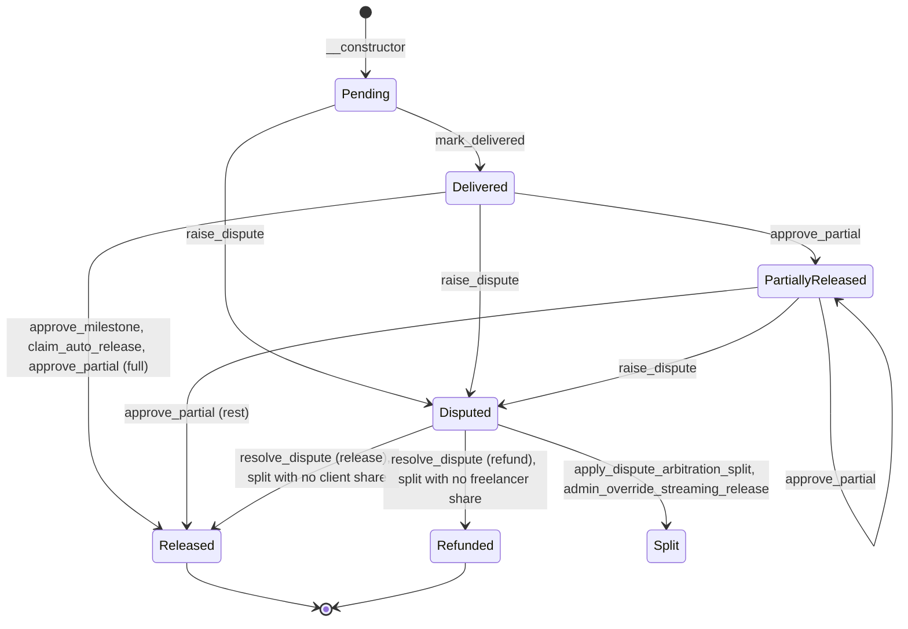
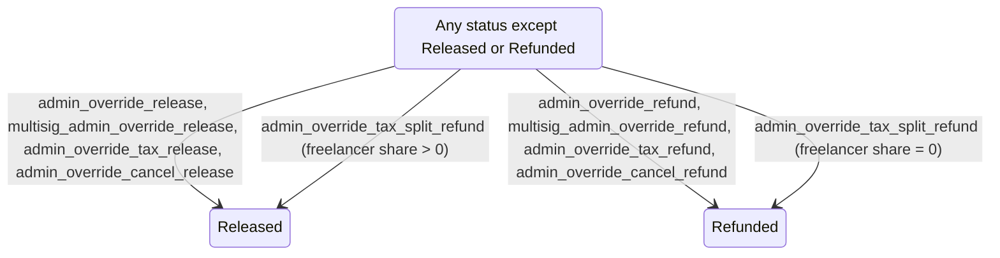
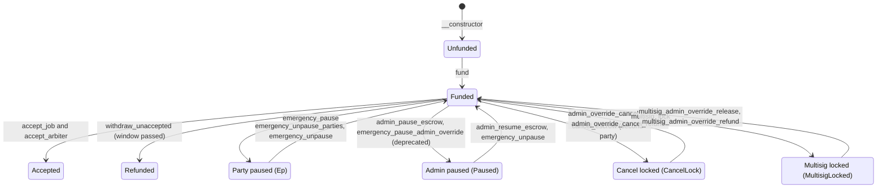

# Milestone Escrow: State Machine Specification

This document is the reference for every state transition in
`contracts/milestone-escrow/src/lib.rs`: which milestone and escrow-level states
exist, which entry point moves between them, who must sign, what tokens move and
which event is published.

PRs that add, remove or change a transition must update this file (see
`CONTRIBUTING.md`).

## Actors

| Actor | Set by | Notes |
|---|---|---|
| Admin | `__constructor`, `transfer_admin`, `execute_admin_transfer` | Platform operator. Controls overrides, pauses, fees, yield, whitelist and upgrades. |
| Client | `__constructor` | Funds the job and approves milestones. |
| Freelancer | `__constructor` | Delivers milestones and receives payouts. |
| Arbiter | `__constructor` | Resolves disputed milestones. |
| Multisig signer | `multisig_approval_init` | Approves proposal IDs (used by `execute_admin_transfer`). |
| Anyone | n/a | May call read-only and calculation endpoints, and `execute_admin_transfer` once it is approved. |

## Milestone states

`MilestoneStatus` has seven values:

| Status | Meaning |
|---|---|
| `Pending` | Created by `__constructor`; not yet delivered. |
| `Delivered` | Freelancer marked it delivered; the auto-release window is running. |
| `PartiallyReleased` | Client released part of the amount with `approve_partial`. |
| `Disputed` | Frozen for arbitration. |
| `Released` | Fully paid to the freelancer. Terminal. |
| `Refunded` | Remaining amount returned to the client. Terminal. |
| `Split` | Remaining amount divided between client and freelancer by an arbitration or streaming split. |

### Normal workflow

### Admin override transitions

## Escrow-level states

These are independent flags stored in instance storage, not mutually exclusive
states.

| Flag | Key | Set by | Cleared by | Checked by |
|---|---|---|---|---|
| Funded | `JobMeta.funded`, `DataKey::FundedAt`, `DataKey::FundedCount` | `fund`, or the last `fund_milestone` (when `FundedCount` reaches `milestone_count`) | never | most settlement entry points (`NotFunded`) |
| Acceptance | `DataKey::Acceptance` (bit 1 freelancer, bit 2 arbiter) | `accept_job`, `accept_arbiter` | never | `mark_delivered`, `raise_dispute`, `resolve_dispute`, `apply_dispute_arbitration_split` (`NotAccepted`), `withdraw_unaccepted` |
| Party pause | `DataKey::Ep` (with `DataKey::EpParty`) | `emergency_pause` | `emergency_unpause_parties`, `emergency_unpause` | `is_paused` |
| Admin pause | `DataKey::Paused` | `admin_pause_escrow`, `emergency_pause_admin_override` (deprecated alias) | `admin_resume_escrow`, `emergency_unpause` | `is_paused` |
| Cancel approval | `DataKey::CancelApproval` (`CancelApprovalRecord`: `mask` + `approved_at`) | `cancel_escrow` (first party) | `revoke_cancel_approval`, `cancel_escrow` (second party), expiry after `CANCEL_APPROVAL_TTL_SECONDS` | `cancel_escrow`, `revoke_cancel_approval` |
| Cancel lock | `DataKey::CancelLock` | `cancel_escrow` (second party) | `admin_override_cancel_release`, `admin_override_cancel_refund` | `ensure_not_paused` |
| Multisig lock | `DataKey::MultisigLocked` | `multisig_lock` | `multisig_admin_override_release`, `multisig_admin_override_refund` | the multisig override and split endpoints |
| Tax record | `DataKey::TaxWithholdingLock(i)` | `tax_withholding_deductions` | `admin_override_tax_release`, `admin_override_tax_refund`, `admin_override_tax_split_refund` | the tax override endpoints |
| Owed balance | `DataKey::Owed(address)`, `DataKey::TotalOwed` | any payout whose transfer fails | `withdraw`, `withdraw_to` | `withdraw`, `withdraw_to`, settlement balance caps |

There are two pauses: the admin pause (`Paused`) and the party pause (`Ep`).
Every entry point reads pause state through one helper, `is_paused`, which is
true while either is set. `assert_not_paused` rejects with `Paused` while
`is_paused` holds; `ensure_not_paused` does the same and also rejects with
`EscrowLocked` while `CancelLock` is set. The emergency refund endpoints
require `is_paused` instead (`NotPaused` otherwise).

## Payouts

Every payout from the contract to the client or freelancer goes through
`pay_or_credit`: the tokens are pushed to the recipient, and if that transfer
fails (for example a classic asset whose recipient has no trustline) the amount
is credited to `DataKey::Owed(recipient)` instead, so the settlement still
completes. The recipient claims credited amounts with `withdraw`. In the tables
below `→ freelancer` and `→ client` mean a payout made this way.

## State-changing entry points

Columns: required signer(s), guards checked before the transition, allowed
source milestone status, resulting status, token movement and published event
topic.

### Setup and funding

| Entry point | Signer(s) | Guards | Source status | Target status | Token movement | Event |
|---|---|---|---|---|---|---|
| `__constructor` | deployer | not initialized; valid addresses; non-empty positive amounts; `0 < auto_release_seconds <= MAX_AUTO_RELEASE_SECONDS` (10 years) | none | every milestone `Pending` | none | `init` |
| `fund` | client | `ensure_not_paused`; not funded | n/a | job `funded = true` | client → contract, total amount | `fund` |
| `add_whitelisted_token` | admin | not funded; whitelist not full | n/a | n/a | none | `wtok` |
| `remove_whitelisted_token` | admin | not funded; token present; not the last token | n/a | n/a | none | `wldel` |
| `accept_job` | freelancer | not already accepted by the freelancer | n/a | sets freelancer acceptance | none | `acceptjob` |
| `accept_arbiter` | arbiter | not already accepted by the arbiter | n/a | sets arbiter acceptance | none | `acceptarb` |
| `withdraw_unaccepted` | client | `ensure_not_paused`; funded; not accepted by both; `ACCEPTANCE_WINDOW_SECONDS` (7 days) passed since funding | every milestone except `Released`, `Refunded` | `Refunded` | → client, sum of remaining | `unaccref` |

### Milestone workflow

| Entry point | Signer(s) | Guards | Source status | Target status | Token movement | Event |
|---|---|---|---|---|---|---|
| `mark_delivered` | freelancer | `ensure_not_paused`; funded; accepted by both | `Pending` | `Delivered` | none | `deliver` |
| `extend_milestone_deadline` | client | `assert_not_paused`; `extra_seconds > 0` | `Delivered`, `PartiallyReleased` | unchanged | none | `extend` |
| `approve_partial` | client | `ensure_not_paused`; funded; `0 < amount <= remaining` | `Delivered`, `PartiallyReleased` | `PartiallyReleased`, or `Released` when fully paid | → freelancer, `amount` | `approve` |
| `approve_milestone` | client | `ensure_not_paused`; funded | `Delivered` | `Released` | → freelancer, remaining | `approve` |
| `claim_auto_release` | freelancer | `ensure_not_paused`; auto-release deadline passed | `Delivered` | `Released` | → freelancer, remaining | `claim` |
| `withdraw` | recipient | owed balance > 0 | n/a | n/a | contract → caller, owed balance | `withdraw` |
| `withdraw_to` | recipient | owed balance > 0; `recipient` not zero or the contract | n/a | n/a | contract → `recipient`, caller's owed balance | `withdraw` |

### Disputes

| Entry point | Signer(s) | Guards | Source status | Target status | Token movement | Event |
|---|---|---|---|---|---|---|
| `raise_dispute` | client or freelancer | `ensure_not_paused`; funded; no dispute lock held; accepted by both; a `Delivered` milestone's auto-release deadline has not passed (`ReviewWindowClosed`) | `Pending`, `Delivered`, `PartiallyReleased` | `Disputed` | none | `dispute` |
| `submit_evidence` | client or freelancer | `ensure_not_paused`; funded; milestone `Disputed`; fewer than `MAX_DISPUTE_EVIDENCE_ENTRIES` hashes recorded | `Disputed` | `Disputed` | none | `evidence` |
| `resolve_dispute` | arbiter | `ensure_not_paused`; funded; accepted by both | `Disputed` | `Released` (release) or `Refunded` (refund) | → freelancer or → client, remaining capped at available balance | `resolve` |
| `apply_dispute_arbitration_split` | arbiter | `ensure_not_paused`; funded; accepted by both | `Disputed` | `Refunded`, `Split` or `Released` depending on the shares | → client and → freelancer by `client_refund_bps`, capped at available balance | `resolve`, `arbsplit` |

`raise_dispute` takes a 32-byte `reason_hash` and persists a `DisputeInfo`
record holding the ledger timestamp (`disputed_at`), the status to restore on
escalation, the `reason_hash`, the caller as `raised_by` (#997), and an evidence
list that starts empty (#712). `migrate` (schema 3 to 4) adds `raised_by` to
disputes that were already open, using the job's client as a placeholder because
the raiser was not stored; the `dispute` event's `caller` is authoritative for
those.
Either party can append up to `MAX_DISPUTE_EVIDENCE_ENTRIES` (10) hashes with
`submit_evidence` while the milestone is `Disputed`; each submission emits
`evidence` and is readable through `get_dispute_info`. Resolving, escalating or
admin-overriding a dispute deletes the record, so the evidence trail never
outlives the dispute it belongs to.

Both closing entry points — `resolve_dispute` and
`apply_dispute_arbitration_split` — additionally take a 32-byte
`decision_hash`: a commitment to the arbiter's written decision (#1015). The
document itself stays off-chain (escrow-backend storage, keyed by the hash);
the contract accepts any 32 bytes without validation, exactly like
`reason_hash`, and echoes the value verbatim in the `resolve` event (and, for
a split, in `arbsplit` too). Because resolution deletes the `DisputeInfo`
record, the emitted event — not storage — is where the commitment survives.

### Cancellation

| Entry point | Signer(s) | Guards | Source status | Target status | Token movement | Event |
|---|---|---|---|---|---|---|
| `cancel_escrow` | client or freelancer | `assert_not_paused`; not cancel locked; funded; positive balance; caller has not already approved an unexpired round | n/a | records (or refreshes) a first approval with `approved_at`; second approval inside the TTL sets `CancelLock` | none | `cxlappr` (mask + `approved_at`), or `cancel` when locked |
| `revoke_cancel_approval` | client or freelancer | not cancel locked; caller has approved | n/a | clears caller's approval | none | `cancelrev` |
| `admin_override_cancel_release` | admin | `CancelLock` set; funded | every milestone except `Released`, `Refunded` | `Released`; clears `CancelLock`; resets `YieldAccrued` | → freelancer, sum of remaining | `adcovls` |
| `admin_override_cancel_refund` | admin | `CancelLock` set; funded | every milestone except `Released`, `Refunded` | `Refunded`; clears `CancelLock` and `YieldAccrued` | → client, sum of remaining | `adcovrf` |

Cancellation is a two-party handshake: one party approves, the `CancelLock` only
fires when the other party approves too. A single-party approval is valid for
`CANCEL_APPROVAL_TTL_SECONDS` (7 days) from `approved_at`. Once that age is
reached the approval is treated as absent (#713): the next `cancel_escrow` call
records a fresh first approval under the caller's bit, restarts `approved_at` at
the current ledger timestamp, and does **not** set the lock. The stale bit is
overwritten, so the original approver must opt in again. `cxlappr` carries
`approved_at` so indexers can compute the same deadline off-chain.

### Admin overrides

| Entry point | Signer(s) | Guards | Source status | Target status | Token movement | Event |
|---|---|---|---|---|---|---|
| `admin_override_release` | admin | funded | any except `Released`, `Refunded` | `Released`; resets `YieldAccrued` | → freelancer, remaining | `admovrls` |
| `admin_override_refund` | admin | `assert_not_paused`; funded | any except `Released`, `Refunded` | `Refunded`; resets `YieldAccrued` | → client, remaining | `admovrf` |
| `admin_override_streaming_release` | admin | funded | `Disputed` | `Refunded`, `Split` or `Released` depending on the shares | → client and → freelancer by elapsed time, capped at available balance | `admstrm` |
| `multisig_admin_override_release` | admin | `MultisigLocked` set; funded | any except `Released`, `Refunded` | `Released`; clears `MultisigLocked` | → freelancer, remaining | `msadmrel` |
| `multisig_admin_override_refund` | admin | `MultisigLocked` set; funded | any except `Released`, `Refunded` | `Refunded`; clears `MultisigLocked` | → client, remaining | `msadmref` |
| `admin_override_tax_release` | admin | funded; tax record present | any except `Released`, `Refunded` | `Released`; removes tax record | → freelancer, net amount | `adtxrls` |
| `admin_override_tax_refund` | admin | funded; tax record present | any except `Released`, `Refunded` | `Refunded`; removes tax record | → client, gross amount | `adtxrfd` |
| `admin_override_tax_split_refund` | admin | funded; tax record present | any except `Released`, `Refunded` | `Released`, or `Refunded` when the freelancer share is zero; removes tax record | → client and → freelancer, net of tax | `adtwsplt` |
| `tax_withholding_deductions` | client and freelancer | funded; `tax_rate_bps <= 10_000` | `Pending`, `Delivered`, `PartiallyReleased` | unchanged; writes tax record | none | `taxwith` |

### Pauses and locks

| Entry point | Signer(s) | Guards | Effect | Token movement | Event |
|---|---|---|---|---|---|
| `emergency_pause` | client and freelancer | not already paused | sets `Ep` and `EpParty` | none | `empause` |
| `emergency_unpause_parties` | client and freelancer | party pause set | clears `Ep` and `EpParty` | none | `emunpausp` |
| `emergency_unpause` | admin | paused | clears `Ep`, `EpParty` and `Paused` | none | `emunpause` |
| `emergency_pause_admin_override` | admin | not already paused | deprecated alias: sets `Paused` | none | `emoverrid` |
| `admin_pause_escrow` | admin | none (no-op when already paused) | sets `Paused` | none | `pause` |
| `admin_resume_escrow` | admin | paused | clears `Paused` | none | `resume` |
| `multisig_lock` | admin | not already locked | sets `MultisigLocked` | none | `mslock` |

### Admin, fees, yield and upgrades

| Entry point | Signer(s) | Guards | Effect | Event |
|---|---|---|---|---|
| `transfer_admin` | current admin | no pending admin transfer | replaces admin | `admin` |
| `propose_admin_transfer` | admin | no pending admin transfer | stores pending transfer | `adminprp` |
| `execute_admin_transfer` | anyone | pending transfer; its proposal reached the multisig threshold | replaces admin; clears pending transfer | `adminexc` |
| `cancel_admin_transfer_proposal` | admin | pending transfer | clears pending transfer | `admincxl` |
| `multisig_approval_init` | admin | not already initialised; valid signer set and threshold | stores signer set and threshold | `msiginit` |
| `multisig_approve` | registered signer | signer registered | sets the signer's bit for the proposal | `msigappr` |
| `set_platform_fee_allocation` | admin | allocation not locked; valid shares | stores allocation | `pf_set` |
| `lock_platform_fee_allocation` | admin | allocation initialised | locks allocation | `pf_lock` |
| `pf_alloc_admin_override` | admin | allocation locked; valid shares | stores allocation, unlocked | `pf_ovr` |
| `set_escrow_interest_yield` | admin | yield state not locked; shares sum to 10 000 | stores yield shares | `yldset` |
| `set_interest_yield_consent` | admin, client and freelancer | yield state not locked; shares sum to 10 000 | stores yield shares | `yldcons` |
| `lock_escrow_interest_yield` | admin | yield state unlocked | locks yield state | `yldlock` |
| `unlock_escrow_interest_yield` | admin | yield state locked | unlocks yield state | `yldunlock` |
| `admin_set_yield_rate` | admin | `assert_not_paused`; not emergency paused; `rate_bps <= 10_000` | stores yield rate | `yldrate` |
| `admin_accrue_yield` | admin | valid milestone; positive amount | adds to `YieldAccrued` | `yldacc` |
| `upgrade` | admin | `ensure_not_paused` | replaces contract code; bumps version | `upgrade` |

### Calculation endpoints

These return a computed split and publish an event, but move no tokens and
change no milestone or escrow state.

| Entry point | Signer(s) | Guards | Event |
|---|---|---|---|
| `split_refund_net_distribution` | none | not paused | `sprefnet` |
| `calculate_platform_fee_split` | none | allocation initialised | `pf_split` |
| `escrow_interest_yield` | none | valid inputs | `intyield` |
| `interest_yield_split_refund` | none | not paused; yield state unlocked | `iyspltref` |
| `tax_withholding_split_refund` | none | valid inputs | `twspltref` |
| `cancel_escrow_split_refund` | none | `ensure_not_paused`; `assert_not_paused` | `cxlspref` |
| `cancel_escrow_claim_refund` | admin | `CancelLock` set | `cxlspref` |
| `multisig_split_refund` | admin | `MultisigLocked` set | `splitref` |
| `multisig_transfer_admin` | admin | valid ratios | `msigtrx` |
| `admin_tax_withholding_deductions` | admin | funded | `taxwh` |
| `emergency_pause_split_refund` | client, freelancer or admin | emergency paused | `epspltref` |
| `emergency_pause_claim_refund` | admin | emergency paused | `emergency_pause_claim_refund` |
| `emergency_pause_allocation` | client, freelancer or admin | emergency paused | `epalloc` |
| `payment_streaming_milestones` | contract, client and freelancer | not paused | `p_stream` |
| `payment_streaming_consent` | client and freelancer | not paused | `p_strcns` |
| `milestone_time_extensions` | contract, client and freelancer | none | `m_ext` |
| `time_extensions_consent` | client and freelancer | not paused | `m_extcns` |

### Milestone scope changes, deadlines and revisions

| Entry point | Signer(s) | Guards | Source status | Target status | Token movement | Event |
|---|---|---|---|---|---|---|
| `add_milestone` | client and freelancer | `ensure_not_paused`; funded; positive `amount`; fewer than `MAX_MILESTONES` (50) | none | new milestone `Pending` (funded) | client → contract, `amount` | `ms_add` |
| `reduce_milestone` | client and freelancer | `ensure_not_paused`; funded; `0 < new_amount < amount` | `Pending` | `Pending` | → client, the difference | `ms_reduce` |
| `increase_milestone` | client and freelancer | `ensure_migrated`; `ensure_not_paused`; `new_amount > amount` | `Pending` | `Pending` | client → contract, the difference (when funded; received amount checked) | `ms_incr` |
| `set_milestone_due_dates` | client | `ensure_migrated`; not funded; freelancer not yet accepted; one entry per milestone; `0` = no deadline, otherwise in the future | n/a | writes `DueAt(index)` (TTL-extended) | none | none |
| `reclaim_overdue` | client | `ensure_migrated`; `ensure_not_paused`; milestone funded; `DueAt + OVERDUE_GRACE_SECONDS` (1 day) passed | `Pending` | `Refunded` | → client, remaining | `overdue` |
| `mark_delivered_with_hash` | freelancer | as `mark_delivered`, plus `ensure_migrated`; stores the 32-byte `deliverable` hash on the milestone | `Pending` | `Delivered` | none | `deliver` |
| `request_revision` | client | `ensure_migrated`; `ensure_not_paused`; funded; review window open; `revision_count < MAX_REVISIONS` (3) | `Delivered` | `Pending`; clears `delivered_at`; increments `RevCnt` | none | `msrev` |
| `trigger_auto_release` | anyone (`caller` is recorded, not authorized) | `ensure_not_paused`; milestone funded; auto-release deadline passed | `Delivered` | `Released` | → freelancer (the stored freelancer, never `caller`), remaining | `claim` |
| `approve_milestones` | client | `ensure_not_paused`; funded; `1..=MAX_BATCH_APPROVALS` (10) distinct indices, each funded | `Delivered` (each) | `Released` (each) | → freelancer, one transfer of the summed remaining | `approve` (one per milestone) |

### Party and arbiter rotation, escalation and recovery

| Entry point | Signer(s) | Guards | Effect | Token movement | Event |
|---|---|---|---|---|---|
| `replace_arbiter` | client and freelancer | `ensure_migrated`; `ensure_not_paused`; valid address distinct from client and freelancer; no milestone `Disputed` (`DisputePending`) | replaces the arbiter; the new arbiter must `accept_arbiter` | none | `arbchg` |
| `rotate_freelancer` | client and current freelancer | valid address distinct from client and arbiter | replaces the freelancer identity and payout destination; owed credits stay with the old address | none | `freerot` |
| `escalate_dispute` | client or freelancer | `ensure_migrated`; `ensure_not_paused`; funded; dispute timeout elapsed (`DisputeTimeoutNotReached`) | restores the pre-dispute status (keeps `delivered_at`); deletes `DisputeInfo` | none | `dispescal` |
| `sweep_excess` | client or admin | `ensure_migrated`; `ensure_not_paused`; excess > 0 (`NothingToSweep`); balance covers obligations | none | → client, excess | `sweep` |

### Roles, treasury, multisig configuration, tax recipient and maintenance

| Entry point | Signer(s) | Guards | Effect | Event |
|---|---|---|---|---|
| `set_admin_role` | root admin | `ensure_migrated`; valid address | assigns `role` to `new_address` (the root admin's own address resets it) | `rolechg` |
| `propose_treasury_update` | `FeeManager` | `ensure_migrated`; valid address | stores a pending treasury that matures after `TREASURY_UPDATE_DELAY_SECONDS` (7 days) | none |
| `apply_treasury_update` | `FeeManager` | `ensure_migrated`; pending update; timelock elapsed | installs the treasury; clears the pending update | `treasury` |
| `propose_multisig_config` | admin | `ensure_migrated`; multisig initialised; nothing pending (`MultiSigConfigPending`); valid signer set and threshold | stores `PendingMultiSigConfig` and a proposal record; returns the proposal ID | `msigcfgp` |
| `execute_multisig_config` | anyone | `ensure_migrated`; pending config; its proposal reached the **current** threshold | installs the new signer set; consumes the proposal; clears approvals on a pending admin transfer | `msigcfg` |
| `cancel_multisig_config_proposal` | admin | `ensure_migrated`; pending config | clears the pending config; consumes the proposal | `msigcfgx` |
| `set_tax_recipient` | `FeeManager`; **plus client and freelancer once funded** | `ensure_migrated`; valid address; not the contract itself, the client, the freelancer, the arbiter or the acting admin (`InvalidAddress`) | stores `TaxRecipient` (TTL-extended) | `taxrcpt` |
| `migrate` | `Upgrader` | stored schema below `SCHEMA_VERSION` (`AlreadyMigrated` otherwise) | rewrites legacy storage to the current layout; bumps the schema marker | `migrate` |
| `extend_storage` | anyone | initialised | extends the instance TTL and every present milestone-, dispute- and governance-related persistent key (see [Storage TTL policy](#storage-ttl-policy)); no other state change, no tokens | none |

`set_tax_recipient` hardening (#957): before funding the `FeeManager` alone
may set the recipient. After `fund`, the recipient is part of the deal's
economics and is frozen unless the same transaction is also signed by the
client and the freelancer (the co-sign model used by
`set_interest_yield_consent`). Withholdings already recorded keep the
recipient captured in `TaxWithholdingRecipient(index)` at withholding time.

### Additional calculation endpoint

| Entry point | Signer(s) | Guards | Event |
|---|---|---|---|
| `compute_ratio_allocation` | none | at most `MAX_MULTISIG_RATIO_COUNT` ratios (`TooManyParties`); valid inputs | none: pure largest-remainder split with no storage writes or transfers |

## Storage TTL policy

`TTL_THRESHOLD` is 30 days of ledgers (`30 * 24 * 60 * 5`) and `TTL_EXTEND_TO`
is 365 days (`365 * 24 * 60 * 5`). Every persistent write goes through the
single helper `set_persistent`, which writes the value **and** extends that
entry to `TTL_EXTEND_TO`; the `ttl_storage_lint_tests` suite fails if any
other `persistent().set(` call appears in `lib.rs` (#956).

| Key | Storage | Extended on write | Extended on read | Extended by `extend_storage` |
|---|---|---|---|---|
| contract instance (`Job`, `Admin`, pause flags, `TotalOwed`, …) | instance | yes (`bump`) | every state change (`bump`) | yes |
| `Milestone(i)`, `DueAt(i)`, `TimeExt(i)`, `RevCnt(i)` | persistent | yes | — | yes |
| `DisputeInfo(i)` | persistent | yes | yes (`submit_evidence`, `resolve_dispute`, timeout checks) | yes |
| `TaxWithholdingLock(i)`, `TaxWithholdingRecipient(i)`, `MultiSigApproval(i)`, `ArbitrationSplitBps(i)` | persistent | yes | — | yes |
| `Owed(address)` | persistent | yes | yes (`withdraw`, `withdraw_to`, credit path) | no (not enumerable; every read and write extends it) |
| `Reputation(address)` | persistent | yes | — | no (not enumerable) |
| `PendingAdminTransfer`, `AdminProposal(id)` | persistent | yes | yes (`execute_admin_transfer`) | yes (pending transfer and its proposal) |
| `AdminProposalCounter`, `MultiSigConfig`, `PendingMultiSigConfig` | persistent | yes | — | yes |
| `WhitelistedTokens`, `PlatformFeeAllocation`, `TaxRecipient`, `YieldConfig`, `YieldAccrued` | persistent | yes | — | yes |
| legacy persistent `Admin` | persistent | yes when `migrate` copies it; the instance entry is the source of truth since #679 | — | instance bump |

Keepers should call `extend_storage` at least once per `TTL_THRESHOLD`
window for every active escrow. Pure getters do not extend TTLs, so their
read-only footprint stays predictable.

## Fees and limits

| Constant | Value | Applies to |
|---|---|---|
| `MAX_MILESTONES` | 50 | `__constructor`, `add_milestone` |
| `MAX_BATCH_APPROVALS` | 10 | `approve_milestones` |
| `MAX_REVISIONS` | 3 | `request_revision` |
| `MAX_DISPUTE_EVIDENCE_ENTRIES` | 10 | `submit_evidence` |
| `MAX_WHITELIST_SIZE` | 50 | `add_whitelisted_token` |
| `MAX_MULTISIG_RATIO_COUNT` | 255 | `compute_ratio_allocation`, multisig ratio endpoints |
| `MAX_TREASURY_FEE_BPS` | 2 000 (20 %) | platform fee allocation, treasury share |
| `MAX_CLIENT_FEE_BPS` | 5 000 (50 %) | platform fee allocation, client share |
| `MAX_ARBITER_FEE_BPS` | 1 000 (10 %) | arbiter fee set at construction (`get_arbiter_fee_bps`) |
| `DISPUTE_TIMEOUT_SECONDS` | 30 days (allowed range 1–180 days) | `escalate_dispute` |
| `MAX_AUTO_RELEASE_SECONDS` | 10 years | `__constructor` |
| `ACCEPTANCE_WINDOW_SECONDS` | 7 days | `withdraw_unaccepted` |
| `CANCEL_APPROVAL_TTL_SECONDS` | 7 days | `cancel_escrow` |
| `OVERDUE_GRACE_SECONDS` | 1 day | `reclaim_overdue` |
| `TREASURY_UPDATE_DELAY_SECONDS` | 7 days | `apply_treasury_update` |

## Behaviour reference

The sections below were folded in from the former root `SPEC.md` (#958),
which now only points here.

### Funding modes

The escrow supports two funding modes.

#### Upfront (default)

`initialize` always uses `FundingMode::Upfront`. The client calls `fund(client)` once and transfers the sum of every milestone amount. No milestone may be delivered or settled until that full deposit succeeds. Calling `fund_milestone` in this mode returns `InvalidFundingMode`.

#### PerMilestone

`initialize_with_funding_mode(..., FundingMode::PerMilestone)` lets the client fund each milestone independently with `fund_milestone(client, milestone_index)`.

- Only the selected milestone amount is transferred.
- Duplicate funding of the same milestone returns `AlreadyFunded`.
- `fund` is rejected with `InvalidFundingMode`.
- A milestone that is not funded cannot be delivered, approved, disputed, released, refunded, or auto-released (`NotFunded`).
- Unrelated unfunded milestones do not block work on a funded milestone.
- `get_job` exposes each milestone's `funded` flag. `get_funding_mode` returns the mode.

Funding is recorded only after the client balance is confirmed sufficient, so a failed transfer does not mark a milestone funded.

### Conservation

A milestone can never release more than its funded amount. Partial approvals, refunds, and dispute splits operate only against that remaining funded balance.

### Revision workflow

After a milestone is `Delivered`, the authorized client may call
`request_revision(client, milestone_index, note_hash)`.

- The milestone returns to `Pending`.
- `delivered_at` is cleared (persistent and temporary), so the previous
  auto-release window cannot fire.
- `revision_count` increments by one. `MAX_REVISIONS` is 3.
- Further revision requests after the cap return `MaxRevisions`; the client
  must approve, partially approve, or dispute.
- Once the auto-release deadline has passed, `request_revision` returns
  `ReviewWindowClosed`.
- The on-chain event `msrev` carries `milestone_index`, `note_hash`, and
  `revision_count`. The note itself is not stored.
- A later `mark_delivered` writes a fresh `delivered_at` and starts a new
  auto-release window.
- Revision does not change funding, released amounts, or escrow balances.

### Excess asset recovery

`sweep_excess(caller, token)` lets the **client or admin** recover assets that
are not required to settle the escrow.

- Escrow token: sweepable amount is `contract_balance - outstanding_obligations`.
  Obligations are each non-terminal milestone's `amount - released_amount`
  (Pending, Delivered, PartiallyReleased, Disputed), plus any accrued yield.
  Terminal statuses (`Released`, `Refunded`, `Split`) are excluded so they
  cannot be double-counted after settlement.
- If the contract balance is below obligations, the call returns
  `InsufficientBalance` and transfers nothing.
- Zero excess returns `NothingToSweep`.
- Other tokens: the full contract balance is recoverable (they are not used
  for milestone settlement).
- Excess is always sent to the client. Callers cannot pick another recipient.
- Emits `sweep` with token, amount, and recipient.

### Emergency pause control

- `emergency_pause(client, freelancer)`: both parties must authorize. Sets a
  party-owned pause (`EpParty = true`).
- `emergency_unpause_parties(client, freelancer)`: both parties must authorize
  to lift a pause **they jointly created**. One party acting alone is
  `Unauthorized`. This path cannot lift an admin pause.
- `emergency_unpause(admin)`: admin recovery for any pause.
- `admin_pause_escrow(admin)` / `admin_resume_escrow(admin)`: the single admin
  pause (`Paused`). A party unpause cannot lift it.
- `emergency_pause_admin_override(admin)`: deprecated alias that sets the admin
  pause (`Paused`).
- There are two pauses, admin and party, and every entry point checks them
  through one helper; either one blocks the guarded endpoints.
- Unpausing a running escrow returns `NotPaused`.
- Pause state is per contract instance; unpausing one escrow does not affect
  another.

### Dispute semantics

A dispute is raised with `raise_dispute(caller, milestone_index, reason_hash)`.
Either the client or the freelancer may raise it, and the caller must authorize
the call. `reason_hash` is a 32-byte commitment to the off-chain statement that
explains the dispute; it is stored on-chain and echoed in the `dispute` event so
arbiters can anchor the claim without trusting off-chain metadata (#712).
Raise-able statuses and their intended meaning:

| Status at raise time | Allowed? | Meaning                                                                 |
| -------------------- | -------- | ----------------------------------------------------------------------- |
| `Pending`            | No       | Nothing has been delivered to arbitrate — returns `InvalidStatus` (#774, #784). |
| `Delivered`          | Yes      | **Delivery (quality) dispute** on submitted work.                        |
| `PartiallyReleased`  | Yes      | **Remainder dispute** over the not-yet-released balance.                 |
| `Disputed`           | No       | Already disputed — returns `InvalidStatus` (see `DisputeAlreadyRaised` for the lock path). |
| `Released`           | No       | Terminal — returns `InvalidStatus`.                                      |
| `Refunded`           | No       | Terminal — returns `InvalidStatus`.                                      |
| `Split`              | No       | Terminal — returns `InvalidStatus`.                                      |

Notes:

- Raising a dispute moves the milestone to `Disputed` and freezes it. While
  `Disputed`, `mark_delivered` is refused (`mark_delivered` only accepts
  `Pending`), so the way forward is the arbiter, or escalation after the
  dispute timeout (below).
- The arbiter resolves a `Disputed` milestone with one of:
  - `resolve_dispute(release_to_freelancer = true)` → `Released`
  - `resolve_dispute(release_to_freelancer = false)` → `Refunded`
  - `apply_dispute_arbitration_split(client_refund_bps)` → `Split` (full
    refund becomes `Refunded`, full freelancer award becomes `Released`).
  Both closing calls also take a 32-byte `decision_hash`, a commitment to the
  arbiter's written decision that stays off-chain in escrow-backend storage,
  keyed by that hash. The hash is echoed in the `resolve` event (and `arbsplit`
  for a split); it changes neither the outcome nor the fund distribution
  (#1015).
- While a milestone is `Disputed`, either party may anchor evidence with
  `submit_evidence(caller, milestone_index, evidence_hash)`. Each hash is
  appended to the dispute record (at most `MAX_DISPUTE_EVIDENCE_ENTRIES` = 10,
  then `EvidenceLimitReached`), timestamped, and published as an `evidence`
  event. `get_dispute_info` returns the reason hash, `raised_by` (the party
  that called `raise_dispute`, #997), `disputed_at`, the pre-dispute status
  and every evidence entry; the record is deleted when the
  dispute closes, so evidence never outlives the dispute it belongs to (#712).
- If the arbiter has not acted within the escrow's dispute timeout (30 days
  by default, set with `initialize_with_dispute_timeout`), either party may
  call `escalate_dispute` to return the milestone to its pre-dispute status;
  a restored `Delivered` milestone keeps its original auto-release deadline
  (`delivered_at` is not reset), so a dispute → escalate → dispute loop cannot
  extend the review window.
- Once a `Delivered` milestone's auto-release deadline has passed,
  `raise_dispute` returns `ReviewWindowClosed`; the freelancer may claim.
- A freelancer who never delivers is handled by the escrow delivery deadline
  and the cancellation / auto-release paths — `raise_dispute` is not the
  mechanism for non-delivery.
- When a dispute is rejected, no milestone or storage state is mutated.

## Invariants

1. **Conservation.** For every milestone, the amount paid to the freelancer plus
   the amount refunded to the client must not exceed `amount`, and the contract
   must only pay out what it received in `fund`. Owed balances stay inside the
   contract and are excluded from the available balance used by settlement
   caps, so they are always backed.
2. **Terminal states are final.** No entry point accepts `Released` or
   `Refunded` as a source status.
3. **Delivery precedes approval.** `approve_milestone` and `claim_auto_release`
   require `Delivered`; `approve_partial` requires `Delivered` or
   `PartiallyReleased`.
4. **Parties consent before work starts.** Delivery and dispute endpoints
   require that both the freelancer (`accept_job`) and the arbiter
   (`accept_arbiter`) accepted the job; otherwise the client can reclaim the
   escrow with `withdraw_unaccepted` once the acceptance window has passed.
5. **Disputes are resolved only by the arbiter or the admin.** A `Disputed`
   milestone is moved only by `resolve_dispute`, `apply_dispute_arbitration_split`
   (arbiter) or the admin override endpoints.
6. **Who can move funds while paused.**
   - While emergency paused (`Ep`) or cancel locked, every endpoint guarded by
     `ensure_not_paused` is rejected: `fund`, `mark_delivered`,
     `approve_partial`, `approve_milestone`, `claim_auto_release`,
     `raise_dispute`, `submit_evidence`, `resolve_dispute`,
     `apply_dispute_arbitration_split` and
     `upgrade`. The admin override endpoints do not check `Ep`, so only the
     admin can move funds.
   - While admin paused (`Paused`), `admin_override_refund` and
     `extend_milestone_deadline` are rejected.
   - `withdraw` is not gated by any pause, so owed balances can always be
     claimed.
7. **Stale cancel intent never locks.** A single-party cancel approval expires
   `CANCEL_APPROVAL_TTL_SECONDS` after it was recorded. `cancel_escrow` treats an
   expired approval as absent, so the lock can only ever be completed by two
   approvals made within the same 7-day window.

## Read-only endpoints

These neither change state nor publish events: `get_job`, `get_reputation`,
`version`, `is_token_whitelisted`, `get_whitelisted_tokens`,
`time_until_auto_release`, `dispute_arbitration_split`, `is_emergency_paused`,
`get_platform_fee_allocation`, `is_multisig_approved`,
`get_pending_admin_transfer`, `is_escrow_interest_yield_locked`,
`get_escrow_interest_yield`, `get_yield_info`, `is_multisig_locked`,
`get_dispute_info`, `get_arbiter_fee_bps`, `get_funding_mode`,
`get_milestone_due_at`, `get_revision_count`, `get_admin_role`,
`get_pending_multisig_config`, `schema_version`, `get_milestone`,
`get_escrow_state`, `get_milestone_spec_hash` and `get_tax_recipient`.

| Read-only endpoint | Returns |
|---|---|
| `get_arbiter_fee_bps` | arbiter fee in bps; `0` when none was set |
| `get_funding_mode` | `Upfront` or `PerMilestone` (missing storage = `Upfront`) |
| `get_milestone_due_at` | delivery deadline of one milestone; `0` = none (`InvalidMilestone` out of range) |
| `get_revision_count` | revisions requested for one milestone |
| `get_admin_role` | the role's assignee, or the root admin |
| `get_pending_multisig_config` | the pending signer-set change, if any |
| `schema_version` | stored layout version; below `SCHEMA_VERSION` until `migrate` runs |
| `get_milestone` | one milestone, without assembling the job |
| `get_escrow_state` | job, admin, pause flags, cancel state, per-milestone extensions and deadlines, fee allocation and version in one read |
| `get_milestone_spec_hash` | the off-chain description hash committed for one milestone |
| `get_tax_recipient` | the configured tax recipient, or `None` |
